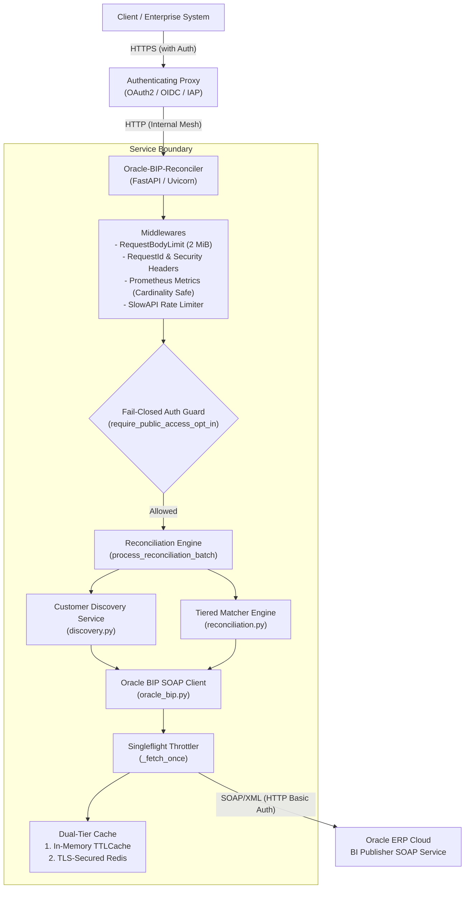
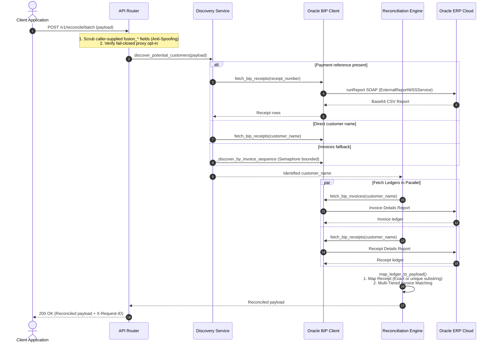
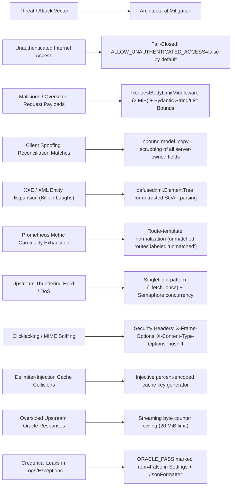

# System Architecture & Technical Specifications

## 1. Overview & System Context

**Oracle-BIP-Reconciler** is an enterprise-grade microservice providing automated invoice and receipt reconciliation against **Oracle ERP Cloud / Oracle BI Publisher (BIP)**. It exposes hardened, rate-limited REST endpoints designed to run behind an authenticating reverse proxy (OAuth2/OIDC/IAP), enforcing a strict fail-closed security posture by default.



---

## 2. Component Architecture

The service adheres to clean layered architecture:

```
src/
├── api/
│   └── routers/
│       ├── health.py            # /health (liveness), /ready (readiness), / (root)
│       └── reconciliation.py   # /v1/reconcile/batch endpoint with anti-spoofing
├── core/
│   ├── config.py                # Pydantic Settings with fail-closed & TLS validators
│   ├── dependencies.py          # Auth dependencies, rate limiter key resolution
│   ├── metrics.py               # Prometheus REQUEST_COUNT, REQUEST_DURATION, RECONCILIATION_COUNT
│   └── middleware.py            # RequestBodyLimitMiddleware (streaming & declared 2 MiB ceiling)
├── services/
│   ├── discovery.py             # 3-step customer resolution (payment ref -> direct -> invoice seq)
│   ├── oracle_bip.py            # SOAP client, Singleflight concurrency, defusedxml parser, caching
│   └── reconciliation.py        # Multi-tiered matching engine, date & float normalization
├── utils/
│   ├── date_formatter.py        # Date normalizer with ambiguity detection (e.g. 05-06-2026)
│   └── validators.py            # Currency, European format, accounting negative float parsers
└── models.py                    # Pydantic models with input bounds and validation assignment
```

---

## 3. End-to-End Reconciliation Flow

When a batch of invoices and payment references arrives at `POST /v1/reconcile/batch`:



---

## 4. Tiered Matching Decision Matrix

Reconciliation follows a deterministic priority hierarchy to prevent false positives:

| Priority | Tier Name | Rule Identifier | Matching Criteria | Refusal / Fallback Conditions |
| :---: | :--- | :--- | :--- | :--- |
| **1** | Exact 3-Way Match | `EXACT_NUMBER_AMOUNT_DATE` | Invoice number exact + Amount exact + Normalized date match | Multiple candidate collisions require exact row identity |
| **2** | Exact 2-Way Match | `EXACT_NUMBER_AMOUNT_OR_DATE` | Invoice number exact + (Amount exact OR Date match) | Falls through if multiple differing candidates exist |
| **3** | Exact 1-Way Match | `EXACT_NUMBER_UNIQUE` | Invoice number exact match alone | Must be strictly unique in candidate pool |
| **4** | Corroborated Fuzzy Match | `NUMBER_AMOUNT_DATE` | Length floor $\ge 5$, typo budget $\le 1-2$, Date & Amount match | Strict length floor $\ge 5$ on both sides |
| **5** | Partially Corroborated Fuzzy | `FUZZY_NUMBER_AMOUNT_OR_DATE`| Fuzzy number match + (Date OR Amount match) | Unambiguous single hit |
| **6** | Fuzzy Number Alone | `FUZZY_NUMBER_ALONE` | Fuzzy number match alone (no date/amount match) | Must be strictly unique; arbitrary indexing refused |
| **7** | Unique Amount Fallback | `AMOUNT_ALONE_UNIQUE` | Exact amount match alone | Must be strictly unique in available ledger |
| **8** | Unique Date Fallback | `DATE_ALONE_UNIQUE` | Exact date match alone | Must be strictly unique in available ledger |
| **—** | Unmatched | `UNMATCHED` | All above rules fail or encounter ambiguous candidates | Marked `UNMATCHED`, returned safely to caller |

---

## 5. Security Architecture & Threat Mitigations



---

## 6. Concurrency & Performance Architecture

1. **Singleflight Throttler (`_fetch_once`)**:
   - Manages an in-flight dictionary mapping cache keys to active asynchronous tasks.
   - Prevents cache stampedes when concurrent callers request the same un-cached customer report.
   - Decoupled from caller cancellation: if caller 1 disconnects, the background fetch completes and serves concurrent callers without spurious cancellations.
2. **Dual-Tier Cache**:
   - Tier 1: In-memory `cachetools.TTLCache` (max 100 entries, 60s TTL).
   - Tier 2: Distributed TLS Redis (`rediss://`) with explicit `socket_timeout=3.0s` and `socket_connect_timeout=2.0s`.
   - Automatic graceful degradation to local cache on Redis network partitions.
3. **HTTP Connection Pooling**:
   - `httpx.AsyncClient` lifecycle managed inside FastAPI `lifespan`.
   - Reuses persistent TCP connections across requests, reducing TLS handshake latency.

---

## 7. Observability & Telemetry

- **Structured JSON Logging**: Every log entry is formatted via `JsonFormatter` into JSON with ISO8601 timestamps, log level, logger name, and optional exception traces.
- **Distributed Request Tracing**: Incoming `X-Request-ID` is extracted or minted via UUIDv4, attached to `request.state`, bound to loggers using `RequestIdAdapter`, and returned in response headers.
- **Prometheus Metrics**:
  - `REQUEST_COUNT` (labels: `method`, `path`, `status_code`)
  - `REQUEST_DURATION` (labels: `method`, `path`)
  - `RECONCILIATION_COUNT` (labels: `status`)
  - Guaranteed bounded cardinality: unmapped route paths collapse into label `path="unmatched"`.

---

## 8. Deployment Models

- **Docker Container**: Rootless execution (`USER 10001:10001`), multi-stage build, base image and `uv` pinned to immutable SHA256 digests.
- **Render (`render.yaml`)**: Pre-configured Blueprint with synchronized environment variable contracts and explicit non-root virtual environment bindings.
- **Vercel (`vercel.json`)**: Serverless function routing via clean entrypoint shim (`api/index.py`).

---

## 9. API Design & Enterprise Integration Standards

### 9.1 RESTful Routing & Versioning
- **Canonical RESTful Resource Endpoint**: `POST /v1/reconciliations` treats reconciliation batches as first-class business resources.
- **Backward-Compatible Action Alias**: `POST /v1/reconcile/batch` remains supported with full feature parity.
- **Operational Endpoints**: `/health` (liveness), `/ready` (readiness), and `/metrics` (Prometheus) reside outside the versioned namespace to conform with cloud orchestrator standards (Kubernetes, AWS ECS).

### 9.2 Rate Limiting & IETF Header Telemetry
The service enforces a rate limit of 10 requests/minute per client IP (or trusted proxy header). When rate limiting is evaluated, the API automatically emits standard telemetry headers:
- `X-RateLimit-Limit`: Maximum permitted request quota within the active time window.
- `X-RateLimit-Remaining`: Remaining request quota before rejection.
- `X-RateLimit-Reset`: Unix epoch timestamp when the current quota window resets.

### 9.3 Synchronous vs. Asynchronous Batch Processing
- **Synchronous Batches ($\le 100$ lines)**: Recommended for interactive workflows, immediate customer payment matching, and automated OCR ingestion pipelines within standard HTTP gateway timeouts (30s).
- **Upper Safety Ceiling (2,500 lines)**: Enforced via Pydantic model bounds to prevent server memory exhaustion.
- **Asynchronous Architecture Blueprint for Massive Runs ($>2,500$ lines)**:
  1. `POST /v1/reconciliations/jobs` $\rightarrow$ Accepts payload, writes to Redis/BullMQ task queue, returns `202 Accepted` with `Location: /v1/reconciliations/jobs/{job_id}`.
  2. Background Worker decomposes invoices into parallel chunks against Oracle BIP with cached customer discovery.
  3. `GET /v1/reconciliations/jobs/{job_id}` $\rightarrow$ Returns job status (`QUEUED`, `PROCESSING`, `COMPLETED`, `FAILED`) and reconciled result.

### 9.4 Comprehensive HTTP Status Code Contract
| Status | Meaning | Typical Trigger | Response Model |
| :---: | :--- | :--- | :--- |
| **`200 OK`** | Reconciliation Successful | Matched batch returned (or `null` if customer identity cannot be isolated). | `ReconciliationRequest` / `ReconciliationBatchResponse` |
| **`413 Content Too Large`** | Request Body Exceeded | Payload exceeds streaming 2 MiB ceiling before parsing. | `ErrorResponse` |
| **`422 Unprocessable`** | Validation or Rule Limit Error | Pydantic validation failure or invoice-only discovery line limit exceeded (>100 lines). | `ErrorResponse` |
| **`429 Too Many Requests`** | Rate Limit Exceeded | Exceeded 10 requests per minute quota window. | `ErrorResponse` |
| **`502 Bad Gateway`** | Upstream Oracle Failure | Oracle ERP Cloud SOAP endpoint unreachable, timeout, or invalid authentication. | `ErrorResponse` |
| **`503 Service Unavailable`** | Proxy Required / Unready | Service running with default fail-closed security (`ALLOW_UNAUTHENTICATED_ACCESS=false`) or credentials missing. | `ErrorResponse` |

